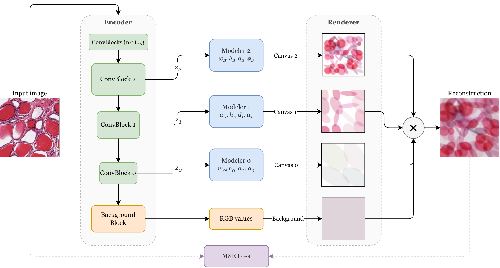

# ASR: Auto-associative Structural Representations

[](https://arxiv.org/abs/2411.12070)
[](https://neurosymbolic-research-group.github.io/ASR/)

Reference implementation of

> **Autoassociative Learning of Structural Representations for Modeling and Classification in Medical Imaging**
> Zuzanna Buchnajzer, Kacper Dobek, Stanisław Hapke, Daniel Jankowski, Krzysztof Krawiec
> [arXiv:2411.12070](https://arxiv.org/abs/2411.12070)

ASR is a neurosymbolic autoencoder. A CNN encoder predicts, at three spatial scales,
a grid of elliptical primitives (scale `w, h`, rotation `d`, RGB appearance). A fixed,
differentiable renderer composes these primitives into an image, and the model learns by
reconstructing its input. The resulting structural representation is then aggregated
over bags of histology patches and classified with a decision tree.

<p align="center">
  
</p>

```
image ──► encoder ──► primitives (8×8, 4×4, 2×2 grids) ──► renderer ──► reconstruction   (Stage 1)
                           │
                           └──► bag statistics (mean, std) ──► decision tree ──► B / H / N   (Stage 2)
```

## Installation

The project uses [uv](https://docs.astral.sh/uv/) and requires Python ≥ 3.12.

```bash
uv sync                    # creates .venv with all dependencies
uv sync --extra patches    # optional: slideio + OpenCV for patch extraction from .svs slides
```

PyTorch is installed from PyPI (CUDA wheels on Linux). For other accelerators, see the
[uv PyTorch guide](https://docs.astral.sh/uv/guides/integration/pytorch/).

## Dataset

Patches were extracted from thyroid whole-slide images of the
[GTEx Biospecimen Research Database](https://brd.nci.nih.gov/brd/image-search/search_specimen?query=tissue%3A%22Thyroid+gland%22&offset=575&max=25).
Three classes were selected based on the annotations available there: **B**enign,
**H**ashimoto and **N**odularity. The selection was not made by medical experts. Per
class, 5 slides are used for training, 2 for validation and 3 for testing.

- Patches (256×256 PNG, 3.6 GB): [Google Drive](https://drive.google.com/file/d/1xpjTIJ1pB9KawD7AveaVTq77OzpM8WwO/view?usp=share_link)
- Slide IDs and splits: [spreadsheet](https://docs.google.com/spreadsheets/d/1Uo58O304mVHFwvxrR2NU-D2r9iXAjQGFOnhlG_-UbcI/edit?usp=sharing)

Extract it so that the layout is:

```
dataset/images/
  train/B-GTEX-XXXX-XXXX/0000.png ...
  valid/...
  test/...
```

The first letter of each slide folder (`B`, `H`, `N`) is its class. Use
`--data-root` or `dataset.root` in the config to point elsewhere.

To regenerate patches from raw Aperio slides, place the `.svs` files in
`dataset/raw_gtex/` and run:

```bash
uv run asr-patches --input dataset/raw_gtex --output dataset/patched_gtex
```

## Reproducing the paper

Configurations for the four models in the paper are in [`configs/`](configs):

| Config | Model |
|---|---|
| `base.yaml` | ASR *Base* |
| `regularized.yaml` | ASR *Regularized* (+ appearance regularisation, ARV) |
| `incremental.yaml` | ASR *Incremental* (scales switched on progressively, ARV from epoch 35) |
| `autoencoder.yaml` | Conventional autoencoder *Baseline* |

Each run writes to `results/<run>/` (change it with `--results-root`).

```bash
# Stage 1: reconstruction
uv run asr-train --config configs/base.yaml --run base
uv run asr-test  --config configs/base.yaml --run base          # results/base/metrics.csv

# Stage 2: bag features + decision tree
uv run asr-features --config configs/base.yaml --run base       # results/base/classification/*_features.csv
uv run asr-classify --config configs/base.yaml --run base       # results.json, tree.pdf, ROC curves
```

Baseline:

```bash
uv run asr-train-ae --config configs/autoencoder.yaml --run ae
uv run asr-test     --config configs/autoencoder.yaml --run ae --model ae
uv run asr-features --config configs/autoencoder.yaml --run ae --model ae
uv run asr-classify --config configs/autoencoder.yaml --run ae
```

The paper reports accuracy ranges over 5 runs. Repeat the runs with different
`training.seed` / `--run` names, or vary only the tree with `asr-classify --seed`.

Every command accepts `--device` (`auto`, `cpu`, `cuda:1`, ...). `asr-train` refuses to
overwrite an existing run unless `--overwrite` is passed, and saves the effective
config to `results/<run>/config.yaml`.

### Outputs

```
results/<run>/
  config.yaml
  models/best.pt, last.pt              # best = lowest validation loss
  plots/loss_plot.png
  plots/{train,valid,test}/rendered_images/*.png
  plots/{train,valid,test}/canvases/*.png   # background, per-scale canvases, merged image
  plots/appearance_hist.pdf
  metrics.csv                          # mse, mae, ssim, mmse, per-scale primitive stats
  classification/
    {train,valid,test}_features.csv
    results.json, tree_params.json, predictions.json
    metrics_bars.png, roc_valid.png, roc_test.png, tree.pdf
```

## Configuration

All settings live in the YAML config (validated on load; unknown keys raise an error).
The shipped configs use the paper's settings. Commonly adjusted options:

| Option | Default | Description |
|---|---|---|
| `training.num_epochs`, `lr`, `batch_size` | 50, 1e-3, 32 | Optimisation (Adam) |
| `training.steps_per_epoch` | 32 | Batches per epoch; `null` = full pass over the training set |
| `training.patience`, `early_stopping_on` | 20, `train` | Early stopping on the `train` or `valid` loss |
| `training.valid_full_pass` | `false` | Validate on `steps_per_epoch` random batches, or on the full split |
| `training.n_border_ignored` | 16 | Border (px) excluded from the masked MSE |
| `training.augment` | `false` | Random flips and right-angle rotations |
| `renderer.beta` | 1.0 | Fuzziness of the primitives |
| `modelers.<j>.*` | off | Incremental schedule per scale (`j = 0` is the finest 8×8 grid): `freeze`, `start_value`, `increment_value`, `epoch_start`, `epoch_period` |
| `arv.*` | off | Appearance regularisation: `enabled`, `start_epoch`, `lambda_a`, `alpha`, `scale_weights` |
| `features.bag_size`, `aggregations` | 16, `[mean, std]` | Bag construction and statistics for Stage 2 |
| `features.encoder_train_mode` | `true` | BatchNorm uses per-bag statistics (`false`: running statistics) |
| `features.dtype` | `float16` | Precision of the stored feature tables |
| `classifier.*` | paper grid | Decision-tree search space, CV folds, `tune_ccp_alpha` |
| `autoencoder.latent_dim`, `ssim_weight` | 200, 0.05 | Baseline size and loss weighting |

See [`src/asr/config.py`](src/asr/config.py) for the full reference.

## Development

```bash
uv run ruff check . && uv run ruff format --check .
uv run ty check
uv run pytest
```

## Citation

```bibtex
@misc{buchnajzer2024asr,
  title         = {Autoassociative Learning of Structural Representations for Modeling and Classification in Medical Imaging},
  author        = {Buchnajzer, Zuzanna and Dobek, Kacper and Hapke, Stanis{\l}aw and Jankowski, Daniel and Krawiec, Krzysztof},
  year          = {2024},
  eprint        = {2411.12070},
  archivePrefix = {arXiv},
  primaryClass  = {cs.CV},
  doi           = {10.48550/arXiv.2411.12070}
}
```

## License

[MIT](LICENSE)
